<div align="center">

# FlashRWKV2

**High-Performance TileLang Operator Library for RWKV-7 — Unified Training, RL Rollout & Packed Serving**

[](https://pypi.org/project/FlashRWKV2/)
[](pyproject.toml)
[](pyproject.toml)
[](pyproject.toml)
[](LICENSE)

English | [简体中文](README_CN.md)

</div>

---

**FlashRWKV2** is the community operator backend for **RWKV-7**, built on **TileLang** for both training and high-throughput serving. It exposes RWKV-7's highest semantic fusion islands (`tokenshift`, `wkv_prepare`, `wkv7`, `readout`, `cmix`, `head`, `sampling`, `mtp`) while keeping tiling, dispatch, and hardware specialization clean and internal.

Complete models, schedulers, and training frameworks stay lightweight in downstream projects — FlashRWKV2 handles the fast, numerically exact kernels underneath.

---

## Why FlashRWKV2?

Choosing an RWKV-7 kernel backend usually involves trade-offs across **backend portability**, **full-layer serving features**, **PEFT integration**, and **train–inference parity**. FlashRWKV2 unifies these capabilities in one TileLang codebase:

| Capability | **FlashRWKV2 (Ours)** | **RWKV-CUDA** (`train_temp`) | **Albatross** | **FLA** (`flash-linear-attention`) |
| --- | --- | --- | --- | --- |
| **Kernel Backend** | **TileLang** (maintainable, GPU-specialized DSL) | Handwritten CUDA only | Handwritten CUDA only | Triton |
| **WKV Formulation** | Exact recurrence (BF16 IO + FP32 accum) | Exact recurrence | FP16 inference recurrence | Chunk-form & fused recurrent (`cu_seqlens` + final state) |
| **Train–Infer Numerical Parity** | **Bitwise-exact with FP32 state** (`fp32io16`); optional FP16 serving state (`fp16`) | Training-only | FP16-only inference (differs from FP32 training) | Separate chunk / recurrent Triton paths |
| **Full-Layer Serving Islands** | **End-to-end** (`tokenshift`, `wkv_prepare`, `wkv7`, `readout`, `cmix`, `head`, `sampling`) | WKV training kernel | Full FP16 inference engine (fixed-batch, no varlen) | WKV-focused operators |
| **Serving State Pool & Live Graphs** | **Built-in** (FP16 + DeltaLog, COW slots, live CUDA Graph metadata validation) | No | Fixed-batch state (no scheduler / varlen) | Functional state I/O (caller manages pools & graphs) |
| **PEFT (LoRA / NoRA)** | **Built-in** (TMix, CMix, LM Head; skips `dW` when frozen) | Limited / manual | No | External wrappers |
| **RL Rollout & InfCtx** | **Bitwise learner–rollout parity** (`fp32io16` + differentiable `rl_infctx`) | No serving rollout | Train–infer FP16 mismatch | Functional recurrent state |
| **Speculative Decoding** | **Built-in** (batched `LightMTP DraftLoop`, scratch verification, state-only commit and optional per-token checkpoints) | No | No | No |

### Key Highlights

- **Bitwise Train–Infer Parity on FP32 State**: Training, prefill, and decode share the same BF16 forward and FP32 accumulation order (fixed key reduction, no split-K). With **FP32 state** (`fp32io16`), RL rollouts, evaluation, and sampling search reproduce the learner's outputs, states, and selected logprobs **bitwise**.
- **Two Serving State Modes**: Use **FP16 state with DeltaLog** (`fp16`) on SM89 (RTX 4090) and SM120 (PRO 6000) to halve state VRAM/bandwidth for general serving (per-token FP16 state rounding means outputs can differ from the FP32 learner), or use **FP32 state** (`fp32io16`) whenever exact training/RL parity is required.
- **First-Class LoRA & NoRA**: Built directly into TMix (`receptance`, `key`, `value`, `output`), CMix (`key`, `value`), and LM Head projections, skipping `dW` automatically when base weights are frozen.
- **Full-Graph `torch.compile` & CUDA Graph**: All training operators support `torch.compile(fullgraph=True)` (including backward and LoRA/NoRA); all serving operators support live-capacity CUDA Graph capture and zero-overhead replay.
- **Universal Source Wheel**: Ships as a lightweight `py3-none-any` wheel with no precompiled binaries or architecture fallbacks — TileLang specializes kernels for your active GPU and caches them on disk.

---

## Architecture at a Glance

```mermaid
flowchart LR
    Emb["Embedding LN0"] --> TS["TMix: tokenshift<br/>(PostNorm + 6-way Shift)"]
    TS --> Prep["TMix: wkv_prepare<br/>(R/K/V + LowRank W/A/G/V + VRes)"]
    Prep --> WKV["TMix: wkv7<br/>(FP32 Train / FP16+DeltaLog Serving)"]
    WKV --> RO["TMix: readout<br/>(Head LN + RKV Res + Gate + Out)"]
    RO --> CMix["CMix<br/>(PostNorm + Shift + ReLU² FFN)"]
    CMix --> PN["PostNorm"]
    PN --> Head["LM Head<br/>(FP32 Logits / Chunked CE / L2Wrap)"]
    Head --> Sample["6-Param Sampling<br/>& LightMTP DraftLoop"]
```



---

## Requirements & Installation

### Requirements

- **Linux** with a CUDA GPU of **Compute Capability 8.0+** (Ampere, Ada SM89, Hopper SM90, Blackwell SM120)
- **Python 3.10+**, **PyTorch 2.11–2.14**, **TileLang 0.1.15**
- System **CUDA Toolkit** matching PyTorch, a **C++20** host compiler, and **Ninja**

### Install from PyPI

```bash
python -m pip install --pre FlashRWKV2
```

Optional — prewarm the small native extension used for packed metadata validation and sampling:

```bash
python -m flashrwkv2.compile
```

### Development Install (`uv`)

```bash
git clone https://github.com/rwkv-rs/FlashRWKV2.git
cd FlashRWKV2
uv sync --group dev
```

> Importing `flashrwkv2` never compiles kernels or creates caches on CPU. TileLang and the native extension compile lazily on first CUDA invocation and persist to disk (`~/.cache/flashrwkv2` or `$FLASHRWKV2_CACHE_DIR`).

---

## Quickstart

### 1. Training WKV-7 with `torch.compile(fullgraph=True)`

```python
import torch
import flashrwkv2

B, T, H, D = 2, 1024, 64, 64
C = H * D
device = "cuda"

r, w, k, v, a, b = (
    torch.randn(B, T, C, device=device, dtype=torch.bfloat16, requires_grad=True)
    for _ in range(6)
)
state = torch.zeros(B, H, D, D, device=device, dtype=torch.float32, requires_grad=True)

# Dense [B, T, C] forward + backward with differentiable FP32 state
y, final_state = flashrwkv2.pretrain_tmix_wkv7_recurrent_bf16(
    r, w, k, v, a, b,
    head_size=D,
    initial_state=state,
    return_final_state=True,
)
y.sum().backward()
```

To preserve exact BF16 intermediate rounding under `torch.compile(fullgraph=True)`:

```python
compiled_model = torch.compile(
    model,
    fullgraph=True,
    options={"emulate_precision_casts": True},
)
```

### 2. Packed Inference with FP16 Serving State

```python
import torch
import flashrwkv2

pool_slots, H, D = 64, 64, 64
device = "cuda"

# Bind a contiguous FP16 state pool (preferred for SM89 / SM120 serving)
raw_pool = torch.zeros(pool_slots, H, D, D, device=device, dtype=torch.float16)
state_handle = flashrwkv2.prepare_tmix_wkv7_recurrent_fp16_state_from_tensor(raw_pool)

# Packed batch: seq 0 has 128 tokens (prefill), seq 1 has 1 token (decode)
cu_seqlens = torch.tensor([0, 128, 129], device=device, dtype=torch.int32)
state_indices = torch.tensor([3, 7], device=device, dtype=torch.int32)
N = int(cu_seqlens[-1])

r, w, k, v, a, b = (
    torch.randn(N, H, D, device=device, dtype=torch.bfloat16) for _ in range(6)
)

# Validate once and reuse the ticket across all layers in the step
ticket = flashrwkv2.prepare_tmix_wkv7_recurrent_metadata(
    cu_seqlens,
    state_indices,
    state_pool_size=pool_slots,
    total_tokens=N,
)

y = flashrwkv2.infer_tmix_wkv7_recurrent_fp16_forward_varlen(
    r, w, k, v, a, b,
    state=state_handle,
    cu_seqlens=cu_seqlens,
    state_indices=state_indices,
    validated_metadata=ticket,
)

# Always materialize before inspecting or copying the bound raw tensor directly
state_handle.materialize_slots_(state_indices)
```

### 3. Speculative Drafting with `LightMTP DraftLoop`

```python
from flashrwkv2.mtp import DraftLoop

loop = DraftLoop.from_state_dict(mtp_weights, lm_head_weight, depth=4)

# CUDA BF16 hidden [B, C] and CUDA int64 token_ids [B]
eager_ids = loop(hidden, token_ids, embed).clone()  # [B, 4]

# Capture separate CUDA Graphs for the batch sizes used by the scheduler
for batch_size in (1, 4, 64, 320, 512):
    loop.capture(embed, batch_size=batch_size)
graph_ids = loop.replay(hidden, token_ids)
```

Drafting retains only the token IDs across steps. Each step releases its FP32 `[B, V]` logits after argmax. The loader supports canonical `mtp.*` weights, legacy `block.*` sidecars, and optional LoRA/NoRA parameters for the LM head.

For low-memory verification, copy active WKV slots into a single-layer scratch pool and run Verify with `save=False`. Pack each sequence's `accepted_b + 1` tokens for Commit and advance the main pool with `r=None`. A live metadata ticket limits each graph replay's slot copy to the active rows. See the [WKV7 recurrence API](docs/kernel_api.md#infer_tmix_wkv7_recurrent_fp16_forward_varlen--fp32io16).

---

## Choosing a Precision & State Mode

| Workload | Recommended WKV API | State Dtype | Why |
| --- | --- | --- | --- |
| **Pretraining / SFT / LoRA / NoRA** | `pretrain_tmix_wkv7_recurrent_bf16` | FP32 | Differentiable state, dense or packed, `torch.compile(fullgraph=True)` |
| **RL Rollout, Eval & Sampling Search** | `infer_tmix_wkv7_recurrent_fp32io16_forward_varlen` + `rl_infctx_tmix_wkv7_recurrent_bf16` | FP32 | **Bitwise identical** outputs, states, and selected logprobs vs learner |
| **General Serving (Prefill + Decode)** | `infer_tmix_wkv7_recurrent_fp16_forward_varlen` | FP16 (+ DeltaLog) | Halved state bandwidth & VRAM, BF16 IO + FP32 math, per-token FP16 rounding |

---

## Historical Acceptance & Performance

The figures below are **historical acceptance records** measured on **SM89 (RTX 4090, 128 SMs)** and **SM120 (RTX PRO 6000, 188 SMs)** at commits [`a239bc3`](https://github.com/rwkv-rs/FlashRWKV2/commit/a239bc3) and [`07c7913`](https://github.com/rwkv-rs/FlashRWKV2/commit/07c7913) (raw paired samples and numerical evidence are archived in `artifacts/cmix-acceptance-a239bc3.json` and `artifacts/sm120-remaining-acceptance-results-07c7913.json`). Runtime changes are validated independently on their own commits via the **Quality Gate** CI workflow.

| Historical Acceptance Metric (`a239bc3` / `07c7913`) | SM89 (RTX 4090) | SM120 (PRO 6000) |
| --- | --- | --- |
| Full block GPU test suite (numerics, state, Graph, compile) | **330 / 330 passed** | **330 / 330 passed** |
| Training workloads within 2% of best internal comparison | **9 / 9** | **9 / 9** |
| Fresh-process disk-cache reuse (cold / warm compilations) | **139 cold / 0 warm** | **137 cold / 0 warm** |

Selected SM120 training latency from commit `07c7913` (B=1, Layer + LM Head, forward + backward + grad zero, paired ABBA CUDA Graph timing; comparison is the fastest of baseline, earlier offline reference, and previous FlashRWKV2 strategy):

| Model & Workload | Best Internal Comparison (ms) | Prepared Strategy (ms) | Change |
| --- | ---: | ---: | ---: |
| RWKV-7 1.5B T=128 (`torch.compile`) | 3.603 | **3.577** | **-0.71%** |
| RWKV-7 7.2B T=1024 (eager) | 32.786 | **32.196** | **-1.80%** |
| RWKV-7 13.3B T=128 (eager) | 7.399 | **7.311** | **-1.20%** |
| RWKV-7 13.3B T=1024 (eager) | 32.897 | **32.267** | **-1.91%** |

### Running Tests & Benchmarks

```bash
# Run full test suite
./.venv/bin/python -m pytest -q

# Benchmark WKV7 across model geometries (with bitwise verification + CUDA Graph timing)
PYTHONPATH=benchmarks ./.venv/bin/python benchmarks/tmix/wkv7/bench.py \
  --shapes h40d64 h64d64 --state-dtype float16 --timing-mode graph \
  --metadata live --slot-order random --state-pool-size 320 \
  --cases 255x1+1x4 255x1+1x256 1x1024

# Benchmark LightMTP DraftLoop (RWKV-7 G1k 7.2B draft shape, B=1/4/64/320/512)
PYTHONPATH=benchmarks ./.venv/bin/python benchmarks/mtp/bench.py --depth 4
```

---

## Documentation

| Document | Audience | Contents |
| --- | --- | --- |
| [Quickstart & Recipes](docs/usr/quickstart.md) | Users | End-to-end training block, LoRA/NoRA, RL rollout, MTP rewind, benchmarks |
| [Serving & State Guide](docs/usr/serving.md) | Serving Engineers | FP16 vs FP32 state, DeltaLog memory budgeting, COW pools, live CUDA Graphs |
| [Kernel API & Numerical Contract](docs/kernel_api.md) | Integrators | Complete operator table, math definitions, shapes, dtypes, compilation rules |
| [CI & Release Acceptance](docs/dev/release.md) | Maintainers | Quality Gate, dual-GPU SM89/SM120 release verification, PyPI publishing |
| [PR Review Guide](docs/dev/pr-review.md) | Contributors | Review checklist and upstream consistency rules |

---

## Acknowledgements & License

- Reference RWKV-7 algorithms and implementations: [BlinkDL/RWKV-LM](https://github.com/BlinkDL/RWKV-LM), [BlinkDL/Albatross](https://github.com/BlinkDL/Albatross)
- LightMTP speculative drafting reference: [Joluck/tilerwkv](https://github.com/Joluck/tilerwkv/commit/409b492e952086a61d89817d8032375a851b51da)
- Kernel DSL & compiler: [TileLang](https://github.com/tile-ai/tilelang)

FlashRWKV2 is distributed under the [MIT License](LICENSE).
