<div align="center">

# FlashRWKV2

**高性能 RWKV-7 TileLang 算子库 —— 统一预训练、微调、RL Rollout 与高并发推理**

[](https://pypi.org/project/FlashRWKV2/)
[](pyproject.toml)
[](pyproject.toml)
[](pyproject.toml)
[](LICENSE)

[English](README.md) | 简体中文

</div>

---

**FlashRWKV2** 是面向 **RWKV-7** 的社区权威高性能算子库，基于 **TileLang** 构建，同时服务于预训练、PEFT 微调、RL Rollout 与线上高并发推理。它对外只暴露模型语义层面的高阶融合岛（`tokenshift`、`wkv_prepare`、`wkv7`、`readout`、`cmix`、`head`、`sampling`、`mtp`），将分块、调度与硬件特化优雅地收敛在内部。

完整模型结构、调度器与训练框架保持由下游项目掌控，FlashRWKV2 专注提供极致性能且数值严格对齐的底层算子。

---

## 为什么选择 FlashRWKV2？

在 RWKV-7 生态中，不同后端在**可维护性、整层推理能力、PEFT 集成与训推数值一致**上各有侧重。FlashRWKV2 在同一套 TileLang 架构下把训练与高并发推理的整层能力统一起来：

| 维度 | **FlashRWKV2（本项目）** | **RWKV-CUDA** (`train_temp`) | **Albatross** | **FLA** (`flash-linear-attention`) |
| --- | --- | --- | --- | --- |
| **实现后端** | **TileLang**（简洁可维护、硬件特化 DSL） | 手写 CUDA（CUDA Only） | 手写 CUDA（CUDA Only） | Triton |
| **WKV 形式** | 精确递推（BF16 IO + FP32 累加） | 精确递推 | FP16 推理递推 | 同时提供 Chunk 形式与 Fused Recurrent（支持 `cu_seqlens` 与最终 state） |
| **训推数值一致** | **FP32 State（`fp32io16`）下逐位一致**；另提供可选 FP16 Serving State（`fp16`） | 仅训练侧 | 仅 FP16 推理（与 FP32 训练存在差异） | Chunk / Recurrent 为独立 Triton 路径 |
| **整层融合算子覆盖** | **端到端整层**（`tokenshift` / `wkv_prepare` / `wkv7` / `readout` / `cmix` / `head` / `sampling`） | WKV 训练内核 | 完整 FP16 推理引擎（固定 batch，无 varlen） | 以 WKV 核心算子为主 |
| **推理状态池与 Live Graph** | **内建支持**（FP16 + DeltaLog、COW 槽位拷贝、Live CUDA Graph 校验） | 不支持 | 固定 batch 状态（无调度、无 varlen） | 函数式 state I/O（状态池与 Graph 由调用方管理） |
| **PEFT（LoRA / NoRA）** | **原生融合**（TMix / CMix / LM Head；冻结基座自动跳过 `dW`） | 支持有限 / 需手改 | 不支持 | 外部封装 |
| **RL Rollout / 无限上下文** | **FP32 State 逐位对齐**（`fp32io16` + 可微 `rl_infctx`） | 无推理 Rollout | FP16 训推不一致 | 函数式递推 state |
| **投机解码（LightMTP）** | **内置支持**（逐 token 状态导出 + `DraftLoop` CUDA Graph） | 不支持 | 不支持 | 不支持 |

### 核心亮点

- **FP32 State 路径下训推逐位一致**：训练、Prefill 与 Decode 共用同一份 BF16 前向与固定顺序 FP32 累加（无 split-K）。在 **FP32 状态（`fp32io16`）** 下，RL Rollout、评测与采样搜索可与 Learner 的输出、状态和选中 logprob **逐位一致**。
- **双模式推理状态池**：SM89（RTX 4090）与 SM120（PRO 6000）常规推理首选 **FP16 状态 + DeltaLog（`fp16`）**，显著降低状态显存与带宽开销（因每 token 后舍入为 FP16，其输出会与 FP32 训练轨迹存在微小差异）；对训推一致敏感的场景请使用 **FP32 状态（`fp32io16`）**。
- **原生 LoRA / NoRA 支持**：直接内建于 TMix（`receptance` / `key` / `value` / `output`）、CMix（`key` / `value`）与 LM Head 投影；冻结基座权重时自动跳过 `dW` 计算。
- **全图 `torch.compile` 与 CUDA Graph**：训练算子全面支持 `torch.compile(fullgraph=True)`（含反向与 LoRA/NoRA）；推理算子支持 Live Capacity CUDA Graph 捕获与零开销重放。
- **纯源码通用 Wheel**：发布轻量级 `py3-none-any` 包，不含笨重预编译二进制或降级分支；首次调用针对当前 GPU 架构原生特化并落盘缓存。

---

## 整体算子流水线

```mermaid
flowchart LR
    Emb["Embedding LN0"] --> TS["TMix: tokenshift<br/>(PostNorm + 六路 Shift)"]
    TS --> Prep["TMix: wkv_prepare<br/>(R/K/V + 低秩 W/A/G/V + VRes)"]
    Prep --> WKV["TMix: wkv7<br/>(FP32 训练 / FP16+DeltaLog 推理)"]
    WKV --> RO["TMix: readout<br/>(Head LN + RKV Res + Gate + Out)"]
    RO --> CMix["CMix<br/>(PostNorm + Shift + ReLU² FFN)"]
    CMix --> PN["PostNorm"]
    PN --> Head["LM Head<br/>(FP32 Logits / 分块 CE / L2Wrap)"]
    Head --> Sample["六参数采样<br/>& LightMTP DraftLoop"]
```



---

## 环境要求与安装

### 环境要求

- **Linux** + **Compute Capability 8.0+** CUDA GPU（Ampere / RTX 4090 SM89 / Hopper SM90 / PRO 6000 SM120）
- **Python 3.10+**、**PyTorch 2.11–2.14**、**TileLang 0.1.15**
- 与 PyTorch 版本匹配的 **CUDA Toolkit**、支持 **C++20** 的宿主编译器与 **Ninja**

### 从 PyPI 安装

```bash
python -m pip install --pre FlashRWKV2
```

可选：提前预热用于 packed 元数据校验和采样的轻量级 native 扩展缓存：

```bash
python -m flashrwkv2.compile
```

### 源码开发安装（使用 `uv`）

```bash
git clone https://github.com/rwkv-rs/FlashRWKV2.git
cd FlashRWKV2
uv sync --group dev
```

> 仅 `import flashrwkv2` 不会在 CPU 上触发编译或写入缓存。TileLang 算子与 native 扩展会在首次 CUDA 调用时按需编译并持久化（默认 `~/.cache/flashrwkv2`，可通过 `FLASHRWKV2_CACHE_DIR` 指定）。

---

## 快速上手

### 1. 训练 WKV-7 与 `torch.compile(fullgraph=True)`

```python
import torch
import flashrwkv2

B, T, H, D = 2, 1024, 64, 64
C = H * D
device = "cuda"

r, w, k, v, a, b = (
    torch.randn(B, T, C, device=device, dtype=torch.bfloat16, requires_grad=True)
    for _ in range(6)
)
state = torch.zeros(B, H, D, D, device=device, dtype=torch.float32, requires_grad=True)

# 支持 dense [B, T, C] 或 packed [N, H, D]（传 cu_seqlens），FP32 状态全程可微
y, final_state = flashrwkv2.pretrain_tmix_wkv7_recurrent_bf16(
    r, w, k, v, a, b,
    head_size=D,
    initial_state=state,
    return_final_state=True,
)
y.sum().backward()
```

使用 `torch.compile(fullgraph=True)` 时开启 Inductor 的精度舍入保持选项，以保证与 eager 梯度逐位一致：

```python
compiled_model = torch.compile(
    model,
    fullgraph=True,
    options={"emulate_precision_casts": True},
)
```

### 2. 高并发 Packed 变长推理（FP16 Serving State）

```python
import torch
import flashrwkv2

pool_slots, H, D = 64, 64, 64
device = "cuda"

# 绑定连续 FP16 状态池（SM89 / SM120 常规推理首选）
raw_pool = torch.zeros(pool_slots, H, D, D, device=device, dtype=torch.float16)
state_handle = flashrwkv2.prepare_tmix_wkv7_recurrent_fp16_state_from_tensor(raw_pool)

# 混合变长 batch：序列 0 prefill 128 tokens，序列 1 decode 1 token
cu_seqlens = torch.tensor([0, 128, 129], device=device, dtype=torch.int32)
state_indices = torch.tensor([3, 7], device=device, dtype=torch.int32)
N = int(cu_seqlens[-1])

r, w, k, v, a, b = (
    torch.randn(N, H, D, device=device, dtype=torch.bfloat16) for _ in range(6)
)

# 每步校验一次 metadata，所有层复用同一 ticket
ticket = flashrwkv2.prepare_tmix_wkv7_recurrent_metadata(
    cu_seqlens,
    state_indices,
    state_pool_size=pool_slots,
    total_tokens=N,
)

y = flashrwkv2.infer_tmix_wkv7_recurrent_fp16_forward_varlen(
    r, w, k, v, a, b,
    state=state_handle,
    cu_seqlens=cu_seqlens,
    state_indices=state_indices,
    validated_metadata=ticket,
)

# 直接读取或拷贝底层 raw_pool 前，先物化选中槽位（落盘 DeltaLog）
state_handle.materialize_slots_(state_indices)
```

### 3. LightMTP 投机解码草稿循环

```python
from flashrwkv2.mtp import DraftLoop

loop = DraftLoop.from_state_dict(sidecar_weights, lm_head_weight, depth=4, eps=1e-5)

# Eager 模式
eager_ids = loop(hidden, token_ids, embed).clone()

# CUDA Graph 捕获与重放
loop.capture(embed)
graph_ids = loop.replay(hidden, token_ids)
```

---

## 精度与状态模式速查表

| 业务场景 | 推荐 WKV 入口 | State 精度 | 说明 |
| --- | --- | --- | --- |
| **预训练 / SFT / LoRA / NoRA** | `pretrain_tmix_wkv7_recurrent_bf16` | FP32 | 状态可微，支持 dense/packed 与 `torch.compile(fullgraph=True)` |
| **RL Rollout / 评测 / 采样搜索** | `infer_tmix_wkv7_recurrent_fp32io16_forward_varlen` + `rl_infctx_tmix_wkv7_recurrent_bf16` | FP32 | 与训练 Learner 输出、状态、选中 logprob **逐位一致** |
| **线上通用推理（Prefill + Decode）** | `infer_tmix_wkv7_recurrent_fp16_forward_varlen` | FP16 (+ DeltaLog) | 显存与带宽减半，BF16 IO + FP32 算术，每 token 后舍入为 FP16 |

---

## 历史验收与性能记录

以下数据为 **SM89（RTX 4090, 128 SMs）** 与 **SM120（RTX PRO 6000, 188 SMs）** 在历史提交 [`a239bc3`](https://github.com/rwkv-rs/FlashRWKV2/commit/a239bc3) 与 [`07c7913`](https://github.com/rwkv-rs/FlashRWKV2/commit/07c7913) 上的验收记录（原始配对样本与数值证据留存于 `artifacts/cmix-acceptance-a239bc3.json` 与 `artifacts/sm120-remaining-acceptance-results-07c7913.json`）。运行时代码改动按[发版验收流程](docs/dev/release.md)在各自提交上验证。

| 历史验收指标（`a239bc3` / `07c7913`） | SM89 (RTX 4090) | SM120 (PRO 6000) |
| --- | --- | --- |
| 完整 Block GPU 测试套件（数值、状态、Graph、编译） | **330 / 330 通过** | **330 / 330 通过** |
| 训练工作负载达标（与内部最优对比基线误差 ≤ 2%） | **9 / 9** | **9 / 9** |
| 跨进程磁盘缓存复用（冷编译 / 热编译） | **139 冷 / 0 热** | **137 冷 / 0 热** |

提交 `07c7913` 上的 SM120 训练端到端延迟（B=1，单层 + LM Head，含前向、反向与梯度清零，ABBA 配对 CUDA Graph 测量；对比基线为仓库内部 baseline、旧离线参考与上一代策略中的最快者）：

| 模型与负载 | 内部最优对比基线 (ms) | Prepared 策略 (ms) | 延迟变化 |
| --- | ---: | ---: | ---: |
| RWKV-7 1.5B T=128 (`torch.compile`) | 3.603 | **3.577** | **-0.71%** |
| RWKV-7 7.2B T=1024 (eager) | 32.786 | **32.196** | **-1.80%** |
| RWKV-7 13.3B T=128 (eager) | 7.399 | **7.311** | **-1.20%** |
| RWKV-7 13.3B T=1024 (eager) | 32.897 | **32.267** | **-1.91%** |

### 运行测试与性能基准

```bash
# 运行测试套件
./.venv/bin/python -m pytest -q

# WKV7 混合推理基准（含逐位校验与 CUDA Graph 计时）
PYTHONPATH=benchmarks ./.venv/bin/python benchmarks/tmix/wkv7/bench.py \
  --shapes h40d64 h64d64 --state-dtype float16 --timing-mode graph \
  --metadata live --slot-order random --state-pool-size 320 \
  --cases 255x1+1x4 255x1+1x256 1x1024

# LightMTP DraftLoop 基准（RWKV-7 G1k 7.2B 草稿尺寸）
PYTHONPATH=benchmarks ./.venv/bin/python benchmarks/mtp/bench.py --depth 4
```

---

## 文档导航

| 文档 | 适用对象 | 核心内容 |
| --- | --- | --- |
| [快速上手与实战配方](docs/usr/quickstart.md) | 开发者 / 研究者 | 完整 RWKV-7 Block 训练、LoRA/NoRA、RL Rollout、MTP 状态回退、Benchmark |
| [推理服务与状态管理指南](docs/usr/serving.md) | 推理引擎工程师 | FP16 vs FP32 状态选型、DeltaLog 显存规划、前缀缓存 COW、Live CUDA Graph |
| [Kernel API 与数值契约](docs/kernel_api.md) | 框架集成者 | 完整公开算子清单、递推公式、Tensor 布局与编译契约 |
| [发版验收](docs/dev/release.md) | 维护者 | SM89/SM120 双卡验收与手动发布 PyPI |
| [PR 审查指南](docs/dev/pr-review.md) | 贡献者 | 代码审查清单与上游一致性规范 |

---

## 致谢与许可证

- RWKV-7 权威参考实现：[BlinkDL/RWKV-LM](https://github.com/BlinkDL/RWKV-LM)、[BlinkDL/Albatross](https://github.com/BlinkDL/Albatross)
- LightMTP 投机解码参考：[Joluck/tilerwkv](https://github.com/Joluck/tilerwkv/commit/409b492e952086a61d89817d8032375a851b51da)
- Kernel DSL 与编译器：[TileLang](https://github.com/tile-ai/tilelang)

FlashRWKV2 基于 [MIT License](LICENSE) 开源。
