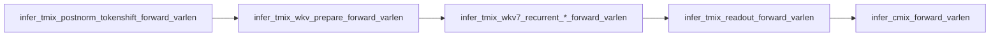

# Serving, State Management & CUDA Graph Guide

This guide covers everything inference engine integrators need to run **FlashRWKV2** in production: state precision selection, DeltaLog memory budgeting, prefix-cache copy-on-write (COW), live CUDA Graph capture, and weight layout conventions.

---

## 1. Inference Pipeline Overview

Each RWKV-7 transformer layer runs four fixed TMix stages followed by CMix:



All stateful stages in the same decoding/prefill step share **one** metadata ticket from `prepare_tmix_wkv7_recurrent_metadata(...)`:
- `infer_tmix_postnorm_tokenshift_forward_varlen`
- `infer_tmix_wkv7_recurrent_fp16_forward_varlen` (or `fp32io16`)
- `infer_cmix_forward_varlen`

---

## 2. FP16 Serving State vs FP32 Parity State

| Aspect | FP16 Serving (`fp16`) | FP32 Parity (`fp32io16`) |
| --- | --- | --- |
| **Bind Handle** | `prepare_tmix_wkv7_recurrent_fp16_state_from_tensor(pool)` | `prepare_tmix_wkv7_recurrent_fp32io16_state_from_tensor(pool)` |
| **Inference API** | `infer_tmix_wkv7_recurrent_fp16_forward_varlen` | `infer_tmix_wkv7_recurrent_fp32io16_forward_varlen` |
| **Compute Arithmetic** | BF16 token IO, FP32 recurrence, FP16 round per token | BF16 token IO, FP32 recurrence, FP32 state |
| **Key Reduction (D64 H40/H64)** | 4 contiguous groups of 16 keys + balanced sum `(s0+s1)+(s2+s3)` | Canonical 64-key FMA scan |
| **DeltaLog Optimization** | Enabled automatically for D64 H40/H64 | None (zero private memory) |
| **Best For** | General online serving on SM89 / SM120 | RL rollout, evaluation, sampling search, train parity |

> **Prefill Scheduling**: On D64 H40/H64 FP16 serving, the device-side metadata validator sorts active sequences by descending length (shared across all layers). With 1–3 prefill rows, 4 CTAs share each head's value columns; with 4+ prefill rows, 1 CTA handles a full head to reuse token vectors. Decode rows independently decide whether to append to their DeltaLog or flush to the base pool.

---

## 3. State Pool Lifecycle, DeltaLog & Prefix-Cache COW

### Materialization Rule (Critical for FP16 Handles)

Because D64 H40/H64 FP16 handles defer decode writebacks into a private **DeltaLog**, the bound raw FP16 tensor may lag behind the logical state until flushed.

- **Before reading, copying, checkpointing, or detaching/replacing the bound tensor directly**: call `handle.materialize_slots_(indices)`.
- **Handle-managed operations handle DeltaLog automatically**:
  - `handle.clone()` — deep copy entire pool
  - `handle.clone_slots(indices)` — clone selected slots into a new handle
  - `handle.copy_(source)` — copy full pool in place
  - `handle.copy_slots_(source, src_indices, dst_indices)` — slot copy with **same-pool overlapping COW support** (`dst_indices` must be unique)
  - `handle.reset_slots_(indices)` — zero selected slots and clear their DeltaLog phase
  - `handle.zero_()` — zero entire pool and clear all DeltaLog phases

### Memory Budgeting (`handle.memory_layout`)

Always size concurrency pools using `handle.memory_layout["bytes_per_slot"]` (`fixed_workspace_nbytes` is always `0`):

```python
layout = state_handle.memory_layout
# {
#   "base_bytes_per_slot": ...,
#   "private_bytes_per_slot": ...,
#   "bytes_per_slot": ...,
#   "fixed_workspace_nbytes": 0,
#   "total_nbytes": ...,
# }
```

Reference memory footprint per slot for D64 (`[H, 64, 64]`):

| Configuration | Base FP16 State / Head | DeltaLog / Head | 32-Layer Per-Sequence Total |
| --- | ---: | ---: | ---: |
| **SM89 RTX 4090 (128 SMs), H64** (2 compact records) | 8,192 B | 1,540 B | 16.000 MiB base + 3.008 MiB log |
| **Other H40 / H64** (1 standard 5-vector record) | 8,192 B | 1,284 B | 16.000 MiB base + 2.508 MiB log (H64) |
| **Other geometries & all FP32 handles** | 8,192 B (FP16) / 16,384 B (FP32) | 0 B | Base only |

---

## 4. Live Metadata & CUDA Graph Capture

For continuous batching inside CUDA Graphs, allocate fixed-capacity metadata buffers and two 1-element CUDA `int32` active-count tensors:

```python
import torch
import flashrwkv2

TOKEN_CAP = 512
SEQ_CAP = 256
MAX_SEQLEN_CAP = 512
POOL_SLOTS = 320

cu_seqlens = torch.zeros(SEQ_CAP + 1, device="cuda", dtype=torch.int32)
state_indices = torch.arange(SEQ_CAP, device="cuda", dtype=torch.int32)
num_active_tokens = torch.zeros(1, device="cuda", dtype=torch.int32)
num_active_sequences = torch.zeros(1, device="cuda", dtype=torch.int32)

def make_ticket():
    return flashrwkv2.prepare_tmix_wkv7_recurrent_metadata(
        cu_seqlens,
        state_indices,
        state_pool_size=POOL_SLOTS,
        token_capacity=TOKEN_CAP,
        sequence_capacity=SEQ_CAP,
        max_seqlen_capacity=MAX_SEQLEN_CAP,
        num_active_tokens=num_active_tokens,
        num_active_sequences=num_active_sequences,
    )

# 1. Zero-active warmup on the capture stream (compiles kernels without mutating state)
side = torch.cuda.Stream()
with torch.cuda.stream(side):
    warmup_ticket = make_ticket()
    run_model_step(x_buf, validated_metadata=warmup_ticket)

# 2. Capture graph (call make_ticket() inside capture so device validation & sort are captured)
graph = torch.cuda.CUDAGraph()
with torch.cuda.graph(graph, stream=side):
    live_ticket = make_ticket()
    y_buf = run_model_step(x_buf, validated_metadata=live_ticket)

# 3. Replay for any active batch <= capacity (no recompilation, no host sync)
cu_seqlens[: B + 1].copy_(active_cu)
state_indices[:B].copy_(active_slots)
num_active_tokens.fill_(active_tokens)
num_active_sequences.fill_(B)
graph.replay()
```

### Live Metadata Safety Guarantees

- **Zero-active warmup** leaves all state pools untouched.
- **Invalid metadata** during replay is caught by the device validator and leaves all state pools untouched.
- **Inactive padded rows** (`row >= num_active_tokens`) receive `NaN` outputs and must not be consumed downstream.

---

## 5. Weight Layout Conventions

FlashRWKV2 avoids copying or materializing transposes at runtime by passing views with native strides directly into TileLang MMA kernels:

| Weight Group | Training Entry (`pretrain_*`) | Inference Entry (`infer_*`) |
| --- | --- | --- |
| Dense projections (`R`, `K`, `V`, `O`, `LM Head`) | `[out, in]` | `[out, in]` |
| WKV Prepare low-rank (`w1/w2`, `a1/a2`, `g1/g2`, `v1/v2`) | `[in, out]` | Original `[out, in]` **or** `*_runtime` `[in, out]` |
| CMix `key_weight` | `[F, C]` | `[F, C]` |
| CMix `value_weight` | `[C, F]` | `[F, C]` (runtime layout) |
| Decay bias `w0` | Added in `pretrain_tmix_wkv_prepare_bf16` | Passed as `decay_bias=w0` to `infer_tmix_wkv7_recurrent_*` |

Both original and runtime layouts execute the exact same increasing-K BF16 MMA accumulation order.
